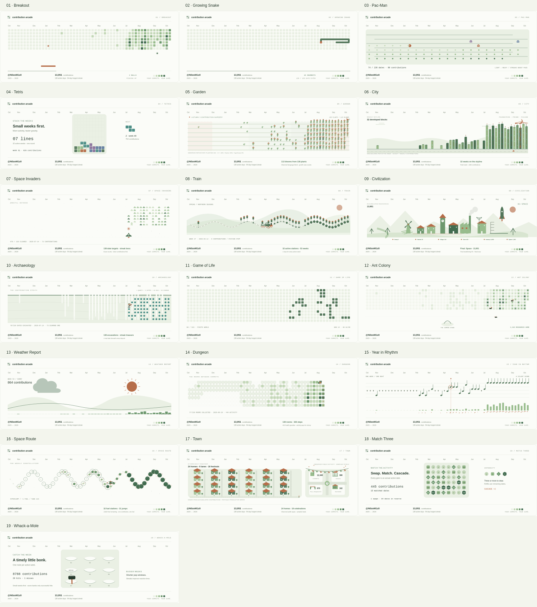

# Contribution Arcade

Nineteen small worlds, made from a year of GitHub contributions.

The homepage keeps every scene together. Filter by category, pause or replay each board independently, and switch between Midnight and Paper. Every scene uses the original full contribution graph, displayed at a readable full width. Each scene also works as a script-free animated SVG in a GitHub README.

<picture>
  <source media="(prefers-color-scheme: dark)" srcset="previews/collection-dark.png">
  
</picture>

## The collection

| # | Scene | What happens | Animation |
| --- | --- | --- | --- |
| 01 | Breakout | Swept collisions, stronger bricks, one ball gradually becoming two and three | [SVG](generated/breakout-dark.svg) · [GIF](previews/breakout.gif) |
| 02 | Growing Snake | Body-safe routes eat exact counts from small to large; gradual, capped growth | [SVG](generated/snake-dark.svg) · [GIF](previews/snake.gif) |
| 03 | Pac-Man | Fixed calendar pellets, planned low-count routes, and three trail-chasing ghosts | [SVG](generated/pacman-dark.svg) · [GIF](previews/pacman.gif) |
| 04 | Tetris | Date-driven tetrominoes on the original graph, legal drops and row clears | [SVG](generated/tetris-dark.svg) · [GIF](previews/tetris.gif) |
| 05 | Garden | Activity-grown plants, flowers, observed language varieties and seasons | [SVG](generated/garden-dark.svg) · [GIF](previews/garden.gif) |
| 06 | City | Weekly construction, activity-scaled heights, windows and a moving crane | [SVG](generated/city-dark.svg) · [GIF](previews/city.gif) |
| 07 | Space Invaders | Count-ordered interceptions, projectile impacts and a streak boss | [SVG](generated/invaders-dark.svg) · [GIF](previews/invaders.gif) |
| 08 | Train | A seasonal railway stops at actual active-week stations | [SVG](generated/train-dark.svg) · [GIF](previews/train.gif) |
| 09 | Civilization | Accumulated resources unlock eras; quiet periods weather the settlement | [SVG](generated/civilization-dark.svg) · [GIF](previews/civilization.gif) |
| 10 | Archaeology | A miner excavates ascending-count ore and unlocks streak treasure | [SVG](generated/archaeology-dark.svg) · [GIF](previews/archaeology.gif) |
| 11 | Game of Life | Actual finite Conway B3/S23 generations seeded by active dates | [SVG](generated/life-dark.svg) · [GIF](previews/life.gif) |
| 12 | Ant Colony | Three workers harvest small deposits first and carry resources home | [SVG](generated/ants-dark.svg) · [GIF](previews/ants.gif) |
| 13 | Weather Report | Quiet-week rain, streak sunshine and record-week celebrations | [SVG](generated/weather-dark.svg) · [GIF](previews/weather.gif) |
| 14 | Dungeon | Adjacent room traversal, local fog reveal, real loot and a final encounter | [SVG](generated/dungeon-dark.svg) · [GIF](previews/dungeon.gif) |
| 15 | Year in Rhythm | Weekly beats and activity-shaped notes form a silent moving score | [SVG](generated/music-dark.svg) · [GIF](previews/music.gif) |
| 16 | Space Route | Weekly planets, activity-powered refueling, docking and paid jumps | [SVG](generated/space-route-dark.svg) · [GIF](previews/space-route.gif) |
| 17 | Town | Roads, homes, festivals and optional sampled public civic activity | [SVG](generated/town-dark.svg) · [GIF](previews/town.gif) |
| 18 | Match Three | Legal adjacent swaps, runs of three or more, gravity and finite cascades | [SVG](generated/match3-dark.svg) · [GIF](previews/match3.gif) |
| 19 | Whack-a-Mole | Date-positioned pop-ups on the original graph, timed strikes, misses and scoring | [SVG](generated/whack-a-mole-dark.svg) · [GIF](previews/whack-a-mole.gif) |

[Midnight homepage](previews/preview-dark.png) · [Paper homepage](previews/preview-light.png) · [Mobile homepage](previews/preview-mobile.png) · [Mechanics and evidence](docs/scene-guide.md)

### Breakout

<picture>
  <source media="(prefers-color-scheme: dark)" srcset="generated/breakout-dark.svg">
  
</picture>

Every date retains its calendar position. Contribution levels 1–2 take one hit; levels 3–4 take two. More than 100 active days and a seven-day streak unlock a second ball after ten seconds of play, then a third after twenty-two. Speed increases gradually. `summary.json` records actual hits and clears, including any bricks left at the end of a difficult loop.

### Growing Snake

<picture>
  <source media="(prefers-color-scheme: dark)" srcset="generated/snake-dark.svg">
  
</picture>

The snake eats **exact contribution counts in nondecreasing order**, including counts sharing the same GitHub color. Ties use a short reachable route. It starts with four segments, grows once every five dates, and stops growing at sixteen segments (a smaller limit applies to very narrow boards).

Bright food marks the current smallest remaining count. Higher-count tiles remain dormant floor until their turn, allowing arbitrary count layouts without out-of-order meals. Body-aware breadth-first routes, escape-space checks and safe side steps avoid collisions. Every eaten date is reached by an adjacent grid move. Longer routes take longer rather than teleporting. The visible counter separates dates eaten from body length.

## Run locally

Requires Node.js 20 or later.

```bash
npm ci
npm run generate -- --username N0zoM1z0
npm run preview
```

Open **http://localhost:4173**. All nineteen scenes are on the homepage, one full-width original calendar per row. Offscreen boards pause automatically to reduce rendering work; individual pause states and playback positions survive theme changes. Space toggles the visible scene when the page itself has focus.

The generator reads `GH_TOKEN` or `GITHUB_TOKEN`, falling back to an existing `gh auth login` session. Tokens never enter generated files.

Reproduce the saved example without a token or network request:

```bash
npm run generate -- --input generated/calendar.json --context generated/context.json
```

Omit `--context` for a calendar-only collection. Additional options are `--output DIRECTORY` and `--seed NAME` (Breakout variations).

## Use any scene in a profile README

Replace `snake` with any scene ID from the table:

```html
<picture>
  <source media="(prefers-color-scheme: dark)"
    srcset="https://raw.githubusercontent.com/N0zoM1z0/contribution-arcade/main/generated/snake-dark.svg">
  
</picture>
```

Animated exports contain no JavaScript or external dependencies. Reduced-motion visitors see a scene-specific still frame. Use `ID-dark-static.svg` or `ID-light-static.svg` when animation is unsuitable. The README image examples and browser gallery use the same SVG files.

## Data and interpretation

Every scene retains **exactly the original calendar's day tiles and arrangement**: week columns, weekday rows, zero-contribution dates, and partial-week gaps. Changing a day's count cannot change where that date appears. There is no count-sorted replacement calendar, packed active-day maze, separate 3×3 mole board, or unrelated puzzle mesh.

Actors and game effects operate over that fixed graph. Pac-Man, Snake, mining, and harvesting plan their targets from the smallest remaining exact count. Future tiers can be crossed as dormant floor without early consumption. Whack-a-Mole emerges at each actual active date's own tile. Tetris uses one source piece per active date on the original graph's columns and seven weekday rows, with missing dates unavailable; narrow histories can lack room for a tetromino. Match Three starts at the original date slots, then performs explicit swaps and gravity with the actual finite gems. Forced matches and cascades retain matching rules rather than claiming individually sorted consumption.


`calendar.json` preserves GitHub's actual date counts, weekday positions, missing dates and contribution levels. Contribution totals include activity visible to the supplied token and follow profile settings; they include more than commits. The checked-in calendar is the public snapshot used by the scheduled workflow.

Optional `context.json` stores an **observed public sample**, filtered to exclude private repositories. It covers up to 100 repositories per activity type and the first 100 commit-contribution days per repository. Language weights use repository primary languages and sampled commit counts. They describe an aggregate planting palette, without assigning languages to particular dates. Issue, pull-request and review counts inform Town's civic buildings; they are labeled sampled totals. The exact observation period and bounds are saved in `coverage`. When enrichment is unavailable, all scenes retain an honest calendar-only mode.

Source API: [GitHub ContributionsCollection](https://docs.github.com/en/graphql/reference/users#contributionscollection).

## Daily updates and reuse

The [update workflow](.github/workflows/update.yml) fetches the latest calendar at **03:23 UTC**, regenerates all nineteen scenes, and commits changed files in `generated/`. It also supports manual dispatch. GitHub may delay scheduled runs. PNG and GIF previews are release snapshots; the daily task updates the canonical SVGs and model summaries.

```yaml
- uses: N0zoM1z0/contribution-arcade@main
  with:
    github_username: ${{ github.repository_owner }}
    output_path: generated
```

| Action input | Default | Purpose |
| --- | --- | --- |
| `github_username` | Repository owner | Calendar account |
| `github_token` | Workflow token | GitHub API access |
| `output_path` | `generated` | Output directory |
| `seed` | Account name | Deterministic Breakout variations |

The action generates files; the calling workflow decides how to publish them. Pin it to a commit for a fixed version.

For each scene ID, the generator writes four SVGs and `ID-summary.json` with duration, metrics, checkpoints and events. Breakout retains the compatible `summary.json` filename; Snake includes per-meal date, exact count and length. `arcade.json` is the complete homepage catalog. `calendar.json` and `context.json` support offline reproduction.

## Verify and export previews

```bash
npm test
npx playwright install chromium
npm run capture
```

Model tests check actual rules and accounting, including row compaction, legal matching swaps, growth and collision boundaries, local fog reveal, fuel conservation, Conway oscillators and empty histories. Chromium checks every scene's visible transitions, both static themes, reduced motion, README image animation, original calendar geometry, gallery categories, independent playback, theme switching and mobile overflow. CI uploads all SVGs, summaries and screenshots.

Export full-loop GIFs with Chromium and FFmpeg:

```bash
node scripts/export-gifs.mjs
node scripts/export-gifs.mjs --scene snake
```

GIFs sample the original timeline at eight frames per second. SVG is the smooth, scalable source. To capture lossless individual frames instead, use `node scripts/capture.mjs --frames --scene SCENE_ID` (twelve frames per second, in `previews/frames/`).

## Acknowledgments

Inspired by [Platane/snk](https://github.com/Platane/snk), [cyprieng/github-breakout](https://github.com/cyprieng/github-breakout), and [danbom's contribution animation](https://github.com/danbom/danbom). The calendar normalization, simulations, models, visual design and SVG renderers here are implemented independently.
