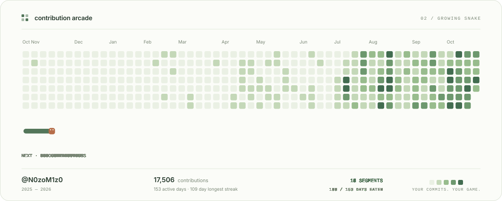

# Contribution Arcade

A little arcade, made from a year of GitHub contributions.

The homepage is a collection of every completed scene. Each one has its own playback controls and SVG download; changing the color theme preserves both playback positions.

### 01 Breakout

<picture>
  <source media="(prefers-color-scheme: dark)" srcset="generated/breakout-dark.svg">
  <source media="(prefers-color-scheme: light)" srcset="generated/breakout-light.svg">
  
</picture>

**Your commits. Your game.** Each date keeps its place in the calendar. Active days become bricks and stronger contribution levels take more hits. Start with one unhurried ball; a long streak brings a second, then a third, with speed building gradually. The original calendar returns at the start of every loop.

[Watch Breakout](previews/breakout.gif)

### 02 Growing Snake

<picture>
  <source media="(prefers-color-scheme: dark)" srcset="generated/snake-dark.svg">
  <source media="(prefers-color-scheme: light)" srcset="generated/snake-light.svg">
  
</picture>

Start with four segments. Every active date is one meal, and every meal adds one segment. The tail stays in place while the head advances into the meal, so the growing body is visible throughout the animation. This example grows to **142 segments** after eating **138 active dates**.

[Watch Growing Snake](previews/snake.gif) · [Midnight collection](previews/preview-dark.png) · [Paper collection](previews/preview-light.png) · [Mobile collection](previews/preview-mobile.png)

## Run locally

Requires Node.js 20 or later.

```bash
npm ci
npm run generate -- --username N0zoM1z0
npm run preview
```

Open **http://localhost:4173** to see both scenes together. Switch between Midnight and Paper, pause either scene, or replay it without resetting the other. Space toggles the visible scene when the page itself has focus. The generator always exports both scenes.

The generator reads `GH_TOKEN` or `GITHUB_TOKEN`. If neither is set, it uses an existing `gh auth login` session. Tokens are used only for the API request and are never written to the output.

To reproduce the checked-in example without a token or network request:

```bash
npm run generate -- --input generated/calendar.json
```

Optional arguments:

```bash
npm run generate -- --username YOUR_USERNAME --output generated --seed my-arcade
```

## Add it to your GitHub profile

The example assets are generated from **N0zoM1z0**. Add this to a profile README to display them:

```html
<picture>
  <source
    media="(prefers-color-scheme: dark)"
    srcset="https://raw.githubusercontent.com/N0zoM1z0/contribution-arcade/main/generated/breakout-dark.svg"
  >
  <source
    media="(prefers-color-scheme: light)"
    srcset="https://raw.githubusercontent.com/N0zoM1z0/contribution-arcade/main/generated/breakout-light.svg"
  >
  
</picture>
```

For Growing Snake, use `snake-dark.svg` and `snake-light.svg` in the same snippet. Add both picture blocks to display the whole collection on your profile.

The SVGs play automatically, contain no JavaScript, and switch to the original calendar for visitors who prefer reduced motion. Static SVGs are also generated for use in places that do not support animation.

## Update automatically

This repository includes a [daily update workflow](.github/workflows/update.yml). It fetches the latest calendar at 03:23 UTC, regenerates both scenes in `generated/`, and commits changed assets. It can also be run manually from the Actions tab. GitHub may delay scheduled runs.

The generator is available as a reusable composite action:

```yaml
- uses: N0zoM1z0/contribution-arcade@main
  with:
    github_username: ${{ github.repository_owner }}
    output_path: generated
```

| Input | Default | Purpose |
| --- | --- | --- |
| `github_username` | Repository owner | Account whose contribution calendar becomes the level |
| `github_token` | Workflow token | Token used to read the calendar |
| `output_path` | `generated` | Output directory relative to the workflow workspace |
| `seed` | Account name | Reproducible auto-player variations |

The action generates files; the calling workflow chooses how to publish them. Use the included workflow to commit them to a repository, or upload them as build artifacts. Pin the action to a commit when you want a fixed version.

## Generated files

| File | Contents |
| --- | --- |
| `breakout-dark.svg` | Animated Midnight Breakout |
| `breakout-light.svg` | Animated Paper Breakout |
| `breakout-dark-static.svg` | Still Midnight Breakout |
| `breakout-light-static.svg` | Still Paper Breakout |
| `snake-dark.svg` | Animated Midnight Growing Snake |
| `snake-light.svg` | Animated Paper Growing Snake |
| `snake-dark-static.svg` | Still Midnight Growing Snake |
| `snake-light-static.svg` | Still Paper Growing Snake |
| `calendar.json` | Saved input for offline reproduction |
| `summary.json` | Breakout contributions, active days, streak, loop duration, hits, and cleared bricks |
| `snake-summary.json` | Snake initial and final length, eaten dates, meal times, and loop duration |
| `arcade.json` | The homepage catalog, with a title, description, and duration for every scene |

Contribution totals include the activity visible to the supplied token and follow GitHub's profile settings. They are contribution totals, rather than commit counts alone.

## How it works

1. **Calendar:** read GitHub's GraphQL contribution calendar, preserving actual weekday coordinates and partial weeks.
2. **Scene:** calculate an automatic game over that calendar. Breakout uses swept collisions and progressive multiball; Growing Snake consumes active dates and extends its body at each meal.
3. **SVG:** turn movement, collisions, and growth into script-free animations. Both scenes share the same card design, calendar coordinates, themes, and reduced-motion behavior.

**Breakout:** levels 1–2 take one hit; levels 3–4 take two. More than 100 active days and a streak of at least seven days unlock a second ball after ten seconds of play and a third after twenty-two. Speed rises smoothly from a relaxed opening to a lively finale. Loops last roughly 12–63 seconds. Difficult calendars may restart before every brick is cleared; `summary.json` records the actual result.

**Growing Snake:** four segments become four plus the number of active dates. A cycle through the grid, with empty turning space beneath the calendar, keeps the head ahead of the body even when every date is active. Food is consumed only when the head reaches its date. A moving window over one SVG trail draws the whole body efficiently, including growth. Loops last roughly 12–57 seconds and eat every active date.

Scenes are deterministic for the same calendar and settings. The checked-in example uses the contribution data visible to the workflow token, so scheduled runs and previews use the same public calendar.

## Verify and capture

```bash
npm test
npx playwright install chromium
npm run capture
```

Tests cover partial weeks, streak gaps, input validation, empty histories, fast collisions, durability, progressive acceleration, safe snake growth, self-collision, narrow boards, deterministic scenes, safe SVG output, and API failures. Browser checks verify both homepage scenes, visible snake growth, meal timing and head position, progressive multiball, independent playback, both themes, mobile overflow, animated README images, and reduced motion. The [CI workflow](.github/workflows/ci.yml) runs both suites and uploads preview artifacts.

To export an animated GIF, install FFmpeg and run:

```bash
node scripts/capture.mjs --frames --scene snake
ffmpeg -framerate 12 -i previews/frames/%04d.png \
  -filter_complex '[0:v]scale=960:-1:flags=lanczos,split[a][b];[a]palettegen=max_colors=96[p];[b][p]paletteuse=dither=bayer:bayer_scale=3' \
  -loop 0 -y previews/snake.gif
```

Use `--scene breakout` and `previews/breakout.gif` to export Breakout instead. This selects the captured scene without changing the homepage collection or removing other exports.

## Acknowledgments

Inspired by [Platane/snk](https://github.com/Platane/snk), [cyprieng/github-breakout](https://github.com/cyprieng/github-breakout), and [danbom's contribution animation](https://github.com/danbom/danbom). This implementation shares the idea of a precomputed SVG performance and implements its own calendar normalization, simulation, visual design, and renderer.
